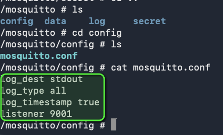

## Deploy Mosquitto message broker with ConfigMap and Secret Volume Types

## Technologies used:

Kubernetes, Docker, Mosquitto

## Project Description:

- Define configuration and passwords for Mosquitto message broker with ConfigMap and Secret Volume types

 

### What I did

Using **Kubernetes**, I deployed the **Mosquitto** message broker from the official `eclipse-mosquitto:2.0` **Docker** image and supplied its configuration and secret data through ConfigMap and Secret volumes rather than baking them into the image.

- **ConfigMap** ([config-file.yaml](config-file.yaml)): defines a `mosquitto.conf` file with logging settings and a listener on port 9001.
- **Secret** ([secret-file.yaml](secret-file.yaml)): stores a base64-encoded `secret.file` of type `Opaque`.
- **Deployment** ([mosquitto.yaml](mosquitto.yaml)): mounts the ConfigMap at `/mosquitto/config` and the Secret, read-only, at `/mosquitto/secret`. For comparison, [mosquitto-without-volumes.yaml](mosquitto-without-volumes.yaml) is the same Deployment without any volumes.
- [example-secret-certificate.yaml](example-secret-certificate.yaml) shows how a PEM certificate could be stored in a Secret the same way.

 

 
_The Mosquitto Deployment is applied and the pod is running. Inside the container, `secret.file` from the Secret is mounted in `/mosquitto/secret`._

 

 
_The `mosquitto.conf` file from the ConfigMap is mounted in `/mosquitto/config` and contains the custom configuration._
